# Full Keys / KeyCards & Locked Chests Guide

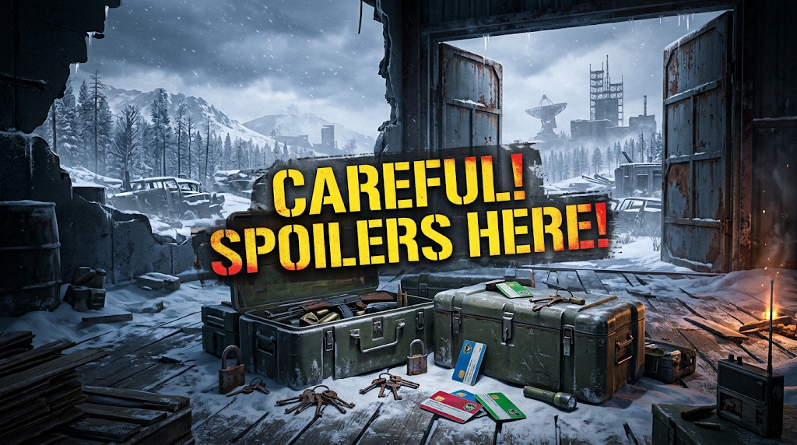

---

## Vorkuta

**Chests Spawning:**
- T4 BodyBags / Chests
- T2 Industrial Crates

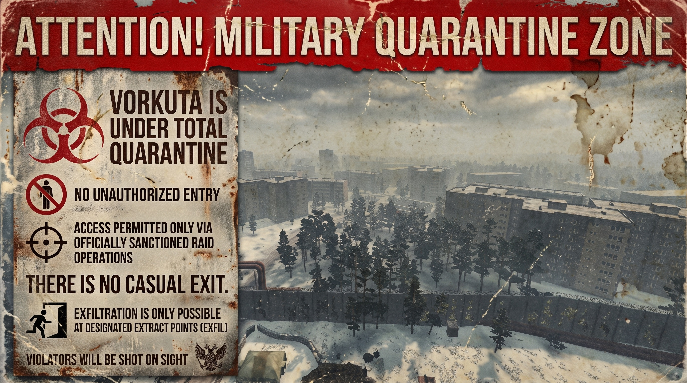

Vorkuta is walled off and completely cut off from fresh-spawn player access. From now on, this is a zone where **only locked chests** spawn!

### Entering Vorkuta (Group Teleport)
The only way to get there is through the new **Group Teleport**, located right behind the **Locked Vorkuta Raid Access Doors**.

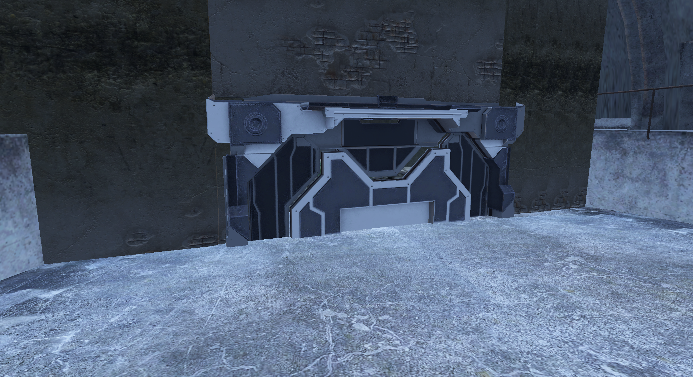

There are **2 places** on the map where these doors are located:
1. Bunker in **Athena Research Institute**
2. **Athena-2 Underground**

Both locations are marked on your map in the Markers tab as **VORKUTA RAID**.

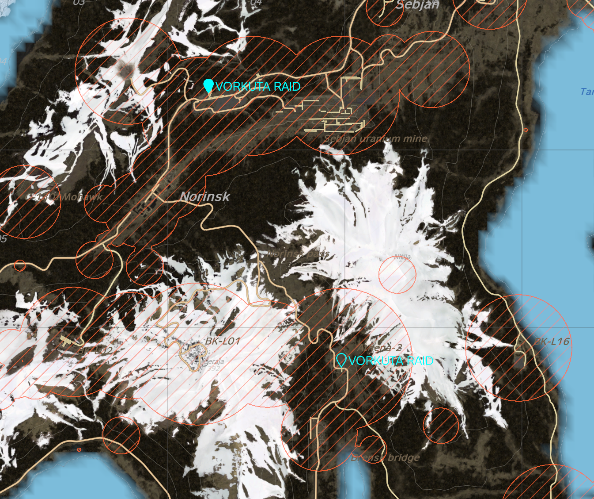

### Door & KeyCard Mechanics
To get teleported, you need to open the **Locked Vorkuta Raid Access Doors**. The only way to open them is by using a **Vorkuta KeyCard**.

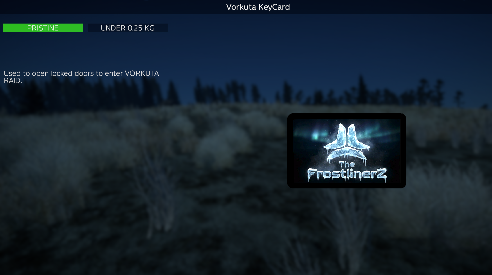

- This KeyCard can be found **only in Locked T3 Chests** with a **100% spawn chance**.
- After using the KeyCard, the doors will trigger an **alarm lasting 1 minute**, audible from **1 km** away.
- **Door opening time:** 1 minute.
- **Door stay-open time:** 15 minutes (during this time, any player can enter the raid!).

### Teleportation Rules
After the doors open, walk onto the teleport spot marked by **small green smoke**.

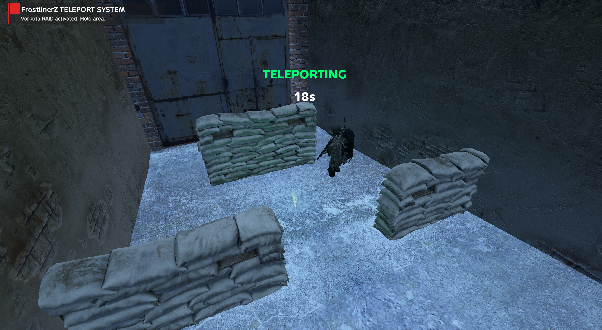

- You must hold position for **20 seconds** before being teleported to Vorkuta.
- A countdown will appear, starting when the first player enters the teleport. The timer is shared by **every** player inside the teleport radius.
- **All players** (including enemies) within that radius will be teleported at the same time to the same place.
- Once teleported, your destination point receives a **2-minute cooldown** before others can teleport to it.
- There are multiple teleport points located around the Vorkuta walls.

### Exiting Vorkuta
- There is only **one exit**, marked with **big red smoke**.
- It uses the same teleport system.
- You will be teleported back to a random location in **T2 or T3 no-build zones**.
- Once teleported, your landing position receives a **2-minute cooldown** before others can teleport to it.

---

## T4 Vorkuta BodyBag Keys

### Loot Table
- 1x T4 Altyn Helmet
- 1x T4 Weapon (`.308`, `7.62x54`, or `6.5 Creedmoor`)
- 1x T3 Storage Kit
- 1x HomeMade C4 *(50% chance)*
- 1x Concrete Mix *(50% chance)*

**Chest Respawn Time:** ~2 hours

### How It Works
Before heading into a Vorkuta Raid, you should bring some keys with you—including **T4 Vorkuta BodyBag Keys**.

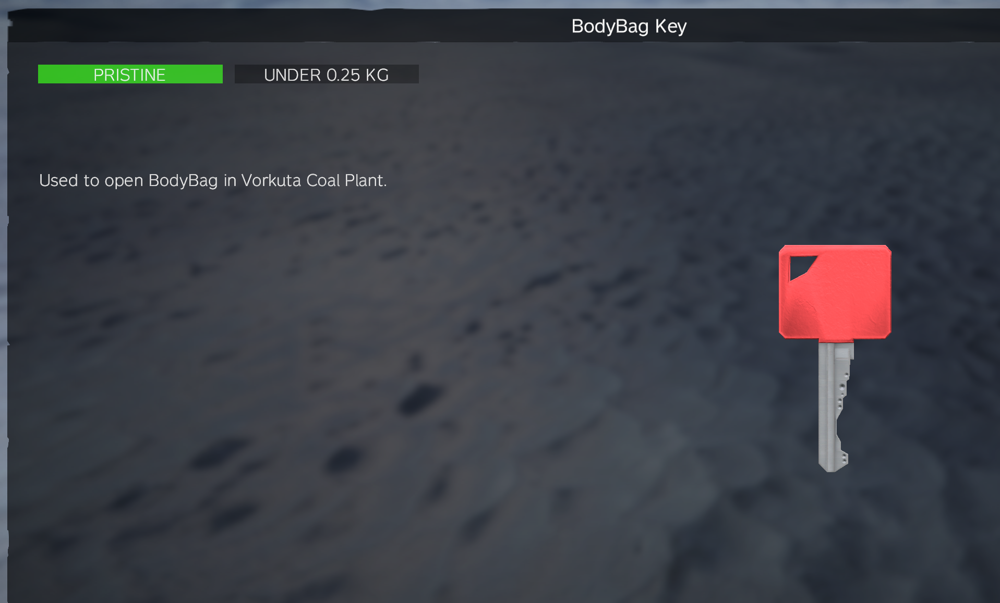

1. Once you find one of these keys, **read its description**. It will tell you where to find the corresponding **Locked BodyBag**.
2. There are **6 different keys** for 6 different locations:

   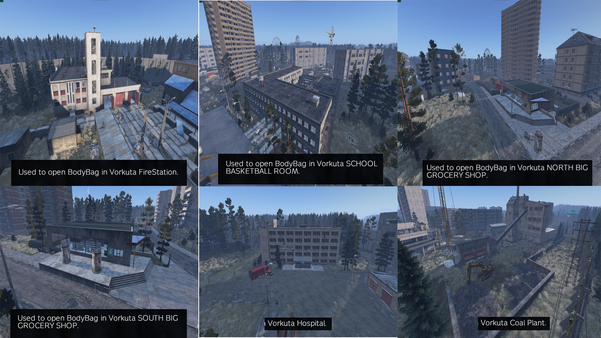

3. The **6 BodyBags** are always in the same locations:

   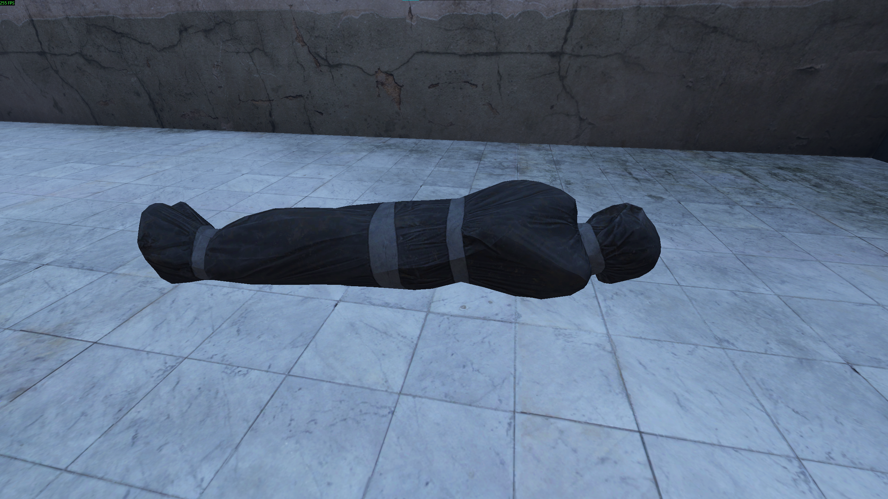

4. Once opened, take the **KeyCard** out of the BodyBag:

   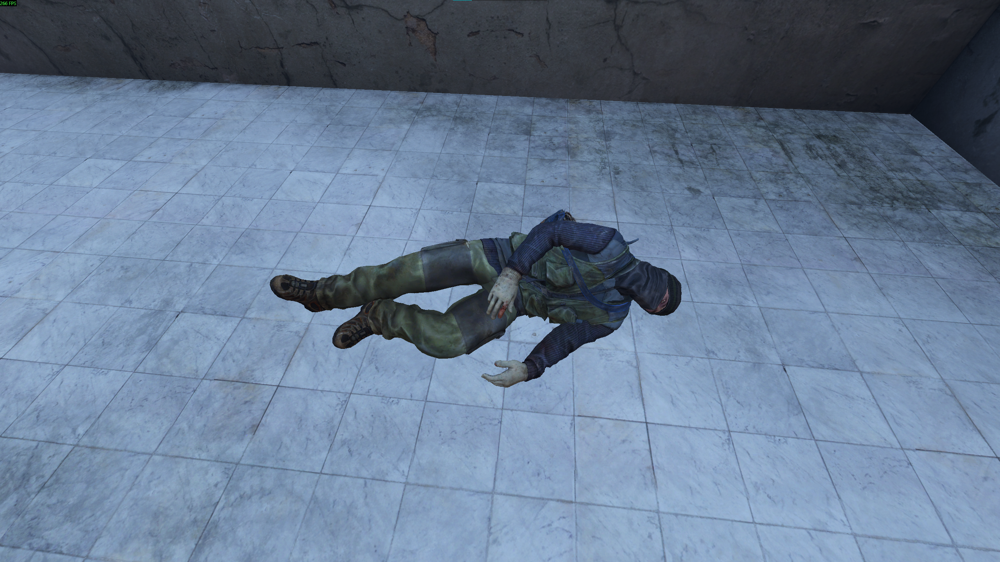

   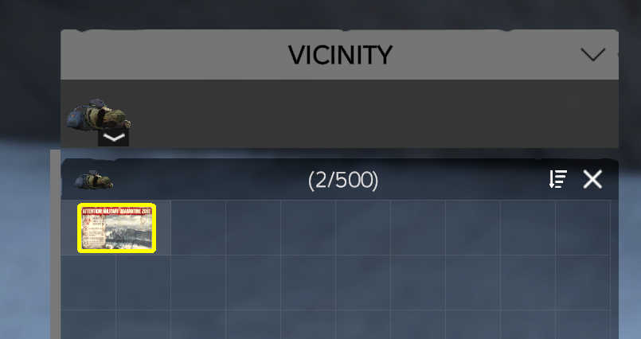

5. This **T4 Vorkuta KeyCard** will reveal the location of your **Locked T4 Military Chest** in its description:

   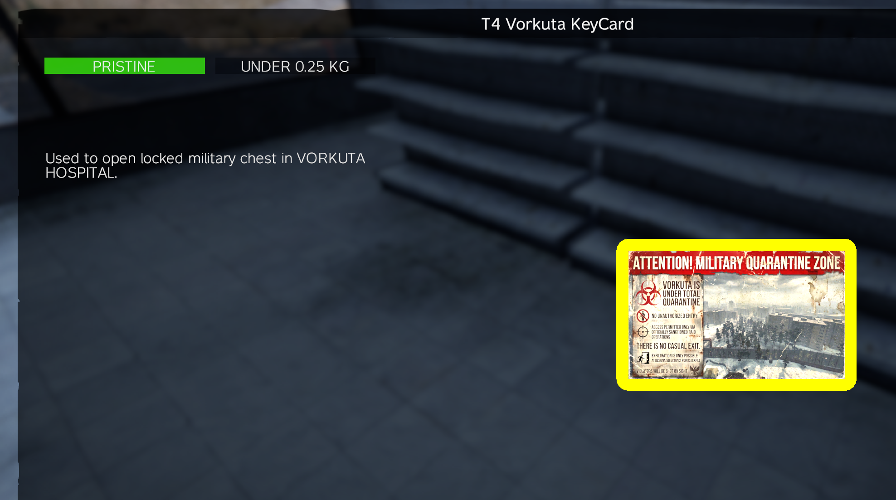

> **Note:** These chests spawn in random locations, so you will have to spend time searching for them!

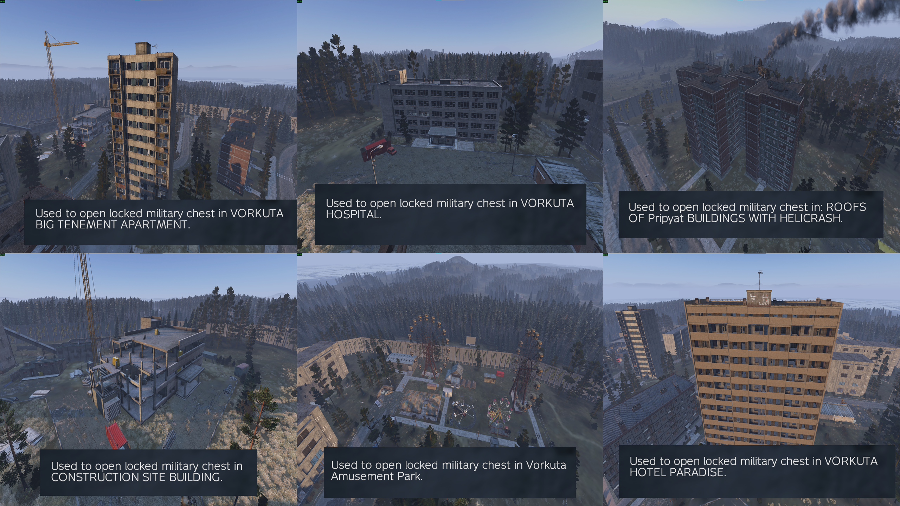

---

## T5 Athena-3 KeyCards

**Chests Spawning:**
- T5 Locked Sci-Fi Chests

### Loot Table
- 1x T4 Heavy Plate
- 1x T4 Weapon (`.308`, `7.62x54`, or `6.5 Creedmoor`)
- 1x T3 Storage Kit
- 1x HomeMade C4 *(50% chance)*
- 1x Concrete Mix *(50% chance)*

**Cooldown / Respawn Time:** ~2 hours

**Chests:**
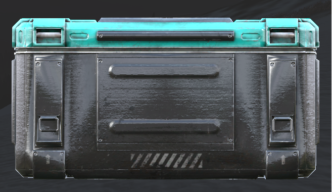

**KeyCard:**
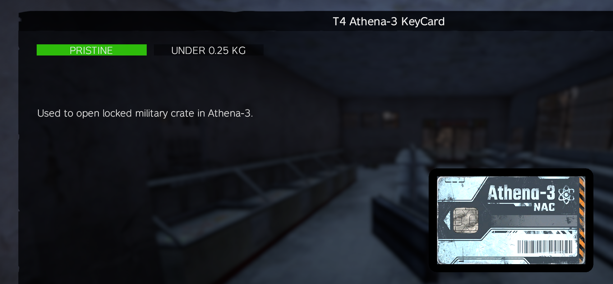

**Location:**
All chests in A3 use the same random spawn point pool, so you will have to spend time finding them!

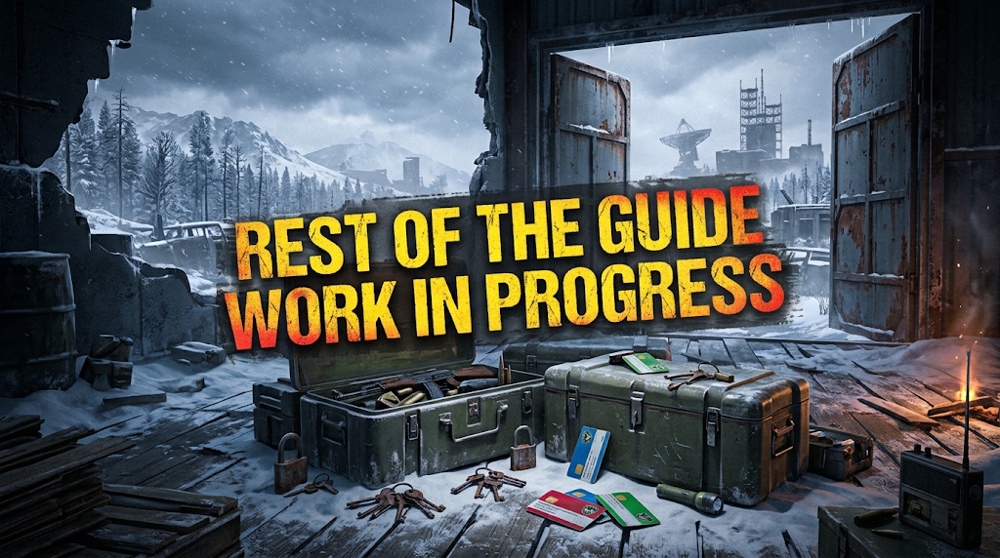
