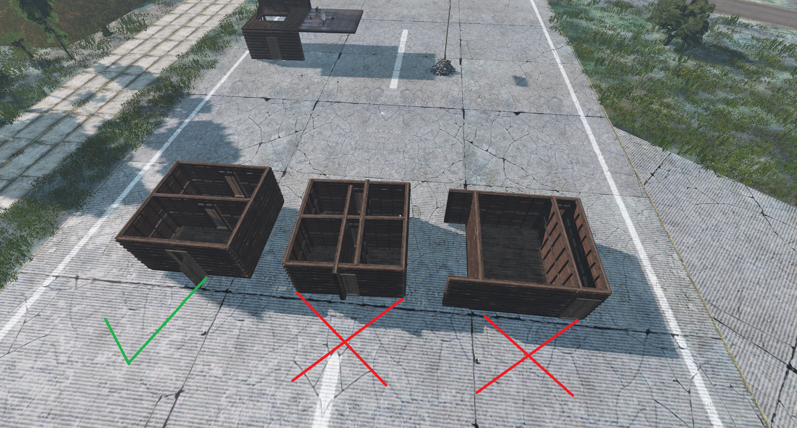

# The FrostlinerZ Server Rules

## General

- **ENGLISH ONLY:** Keep all public Discord channels strictly in English.
- **ADMIN DECISIONS ARE FINAL:** Excessive arguing or hostility toward staff will result in a temporary ban.
- **SUPPORT & HELP:** For in-game assistance, open a ticket. Do not tag staff in public chat or send direct messages (DMs).
- **ZERO TOLERANCE:** No racism, hate speech, political debates, toxicity, or staff disrespect.
- **NO ADVERTISING:** Promoting other servers, communities, or services is strictly prohibited.
- **NO NSFW / INAPPROPRIATE CONTENT:** Strictly no pornography, gore, erotic content, or disturbing media across Discord and in-game profiles (nicknames, profile pictures, bios).
- **IDENTITY:** Your Discord nickname must match your in-game name. Impersonating staff or other players will result in an immediate ban.
- **NO COMBAT LOGGING:**
  - You are not allowed to log out within 5 minutes of taking damage from another player.
  - You are not allowed to log out within 5 minutes of dealing damage to another player.
- **PVP & SPAWN CAMPING:** Kill on Sight (KOS) is permitted 24/7 across the map. However, excessive fresh spawn farming is not allowed.
- **ZONE PROGRESSION (TIER 1 PROTECTION):** You are not allowed to re-enter Tier 1 zones with any military loot obtained in higher-tier zones.
- **NO EXPLOITING OR GLITCHING:** Abusing in-game bugs or glitches to gain an unfair advantage over players is forbidden.
- **RENDERING / HARDLOGGING:** Intentional disconnects or rapid relogging to exploit object rendering glitches is strictly forbidden.
- **NO ALT ACCOUNTS:** Strictly no alt'ing (using more than one account) in any form or shape.
- **NO STREAM SNIPING:** Stream sniping any active content creators playing on the server is strictly forbidden.
- **ITEM COMPENSATION POLICY:** DayZ can be glitchy—be careful where you drop your items to prevent them from clipping or despawning. Item compensation is only considered for items categorized as high-tier value.
- **VISUALS & MODIFICATIONS:**
  - Basic GPU/monitor adjustments (brightness, contrast, sharpness) are allowed. However, using excessive gamma to bypass areas intentionally designed to be pitch black is strictly prohibited.
  - You are not permitted to use any tools or modifications that alter graphics beyond the standard in-game DayZ settings.
  - No `.pbo` modifications, third-party shaders/injectors, or graphic config modifications (including view distance exploits) are allowed.

---

## Teams & Squads

- **MAXIMUM TEAM SIZE:** The maximum team limit is 10 players (up to two 5-man squads).
- **ROSTER ROTATION:** If your group has more than 10 members, you may rotate them. However, no more than 10 players from the team can be active on the server at any given time.
- **TERRITORY & BASE LIMIT:** The maximum number of players permitted inside a team's base, territory, or active squad roaming area is 10.
- **NO ROAMING WITH BENCHED MEMBERS:** Active members are strictly forbidden from grouping, roaming, or playing with teammates who are currently rotated off the active roster.
- **NO MERCENARY / DOUBLE-DIPPER PLAY:** Players rotated off your team are not permitted to play with, assist, or join any other teams during that period.
- **STRICTLY NO ALLIANCES:** Truces, code sharing, base sharing, co-raiding, or third-partying alongside another team are strictly prohibited.

---

## Raiding

- **WEEKEND C4 / HACKSAW RAIDING ONLY:**
  - Base raiding using C4 only on weekends.
  - Storage raiding using hacksaw only on weekends.
  - Destroying Vanilla Rebuild Structures is allowed 24/7.
  - **START:** Saturday 17:00 CEST, **END:** Sunday 23:00 CEST.
- **BREACHING MECHANICS:**
  - Breaching BBP doors, hatches, and gates is conducted strictly by placing C4 on them to destroy the attached Code Lock. Doors, hatches, and gates themselves cannot be destroyed.
  - Dismantling base elements (walls, gates, frames) is disabled and strictly forbidden.
  - Storage containers locked with a Code Lock can be raided using a Hacksaw.
- **REBUILDING POLICY:**
  - Defenders are strictly forbidden from replacing any Code Locks or rebuilding destroyed parts within 30 mins from the last C4 explosion.
- **RAID RECORDING MANDATORY:** When initiating or participating in a raid, you must record your gameplay at all times. Video proof is required to resolve any raid-related disputes or tickets.
- **NO GLITCH RAIDING:** Any form of clipping, exploiting textures, or glitching through walls, windows, or gates is strictly forbidden.
- **BOOSTING MECHANICS:**
  - Player boosting (standing on teammates) is allowed.
  - Item boosting (stacking items/crates to climb) is allowed, provided every item remains in direct contact with the ground or surface below. Floating or levitating items are strictly forbidden.
- **NO BASE TAKEOVERS:** You are strictly forbidden from taking over or claiming another team's base, even if it appears completely abandoned.
- **NO CODE LOCK TROLLING:** You are not allowed to attach your own Code Locks to any gates, doors, or storage items located inside another team's base or territory.
- **CRASHES & RECONNECTING AFTER RAID EXPIRATION:**
  - Intentional logging out inside an enemy base is strictly forbidden.
  - If you crash or disconnect during a raid, you must reconnect as quickly as possible.
  - You are strictly forbidden from engaging in combat, shooting defenders, or taking any loot/items.
  - Defenders have the full right to kill you on sight.
  - You must attempt to leave the base immediately. If leaving is impossible because the base has been re-locked, log out immediately and open a support ticket to be moved outside.
- **FLAG PROTECTION:** You are strictly forbidden from interacting with, dismantling, lowering, or destroying enemy territory flags in any way.

---

## Base Building

- **RESTRICTED AREAS:** Building inside military zones, underground areas, or blocking public water wells is strictly forbidden, even if the area is not explicitly marked on the map as a no-build zone.
- **SPAWN & MILITARY PROTECTION:**
  - Bases cannot have a direct line of sight overlooking player spawn areas.
  - Sniping or shooting at players in spawn areas, military zones, or active event zones from inside/on top of your base is strictly prohibited.
- **BASE RAIDING ACCESSIBILITY:**
  - Your base must be fully raid-able from the ground at all times (no floating/sky bases).
  - Players must not be forced into any crawling, prone, or glitched animation while placing C4 to breach your base.
- **BASE SIZE & STRUCTURAL LIMITS:**
  - **FREE-STANDING BBP BASES:** Maximum total size is a 4x4x4 cube.
  - **FOUNDATIONS & ACCESS:** BBP Foundation blocks are not counted toward the 4x4x4 limit. Stairs and ramps may also sit outside the 4x4x4 footprint, provided they are directly connected to foundations, entrances, or exits.
  - **BASES IN BUILDINGS:** Bases built on existing structures may be a maximum of 3 walls high above the highest point of the structure. Smokestacks, antennas, towers, water tanks, HVAC units, or similar objects may not be used as a foundation for additional building or to gain additional build height on any base built on an existing structure.
  - **DOOR STACKING:** Narrow corridor exploits are forbidden. Inside any 1x1x1 box, you may place only one fully built door or gate, positioned directly in the center of the block.
  - **CODE LOCK CAP:** Maximum of 15 code-locked doors, gates, and hatches per base.
- **PEEKS & WINDOWS:**
  - No "toe peeks" or pixel-gap peeks.
  - Any peek or shooting slit must allow players on both sides to clearly see and shoot each other.
- **TERRITORY & FLAG POLE RULES:**
  - **FLAG LIMIT:** Strictly one base and one flag pole per team (leaving a team to build secondary outposts is forbidden).
  - **RADIUS:** Flag pole radius is 30 meters.
  - **MAINTENANCE:** Keep your flag raised. If your flag drops completely, your base will despawn. Inactive bases without player interaction will despawn after 7 days.
  - **FLAG RELOCATION:** You may move your flag pole, but keep in mind that storage items left uncovered will begin to despawn much faster depending on container type. Move your loot as quickly as possible.
- **BASE RELOCATION PROCEDURE:**
  - Base relocation must be completed within a strict 3-hour window.
  - During the move, you may have locks active on both the old and new bases, but the total combined number across both locations must not exceed 15.
  - After 3 hours, the old base must have ZERO code locks remaining (on both structures and storage).
  - Dismantle remaining old base structures or open a support ticket to have staff remove them.
 

---

## Vehicles & Helicopters

- **NO VEHICLE HOARDING LIMIT:** There is no hard limit on the total number of vehicles you can own, but they all must be covered with camo net.
- **VEHICLE LOCKING & BREAK-INS:**
  - You are allowed to lock and secure any vehicle using vehicle keys to prevent theft while operating out in the world.
  - Locked vehicles can be picked using a Raid Lockpick.
- **VEHICLE LIFETIME & DESPAWN:**
  - Any vehicle left parked or abandoned out in the world has a strict 6 hour despawn timer.
  - To save your vehicles permanently, you must store them under camo net.
  - Vehicles despawned due to exceeding the 6-hour idle timer will not be compensated by staff.
- **DEBUG & OUT-OF-BOUNDS TRAVEL:**
  - Flying helicopters, driving boats, or navigating any vehicle outside the active map boundaries into the debug plains/water is strictly forbidden.
  - Vehicles venturing into debug will glitch, crash, or despawn automatically. No compensation will be granted under any circumstances.
- **BASE LAG & FLIGHT SAFETY:**
  - Approach player bases and dense compounds with caution. Rendering lag and base stutter are natural DayZ engine limitations.
  - Helicopter crashes caused by base render lag or desync are entirely at your own risk (no vehicle or gear compensation).
- **HELICOPTER ROOF SURFING EXPLOIT:**
  - Standing, surfing, or shooting from the top/roof of an airborne helicopter is strictly prohibited.
  - Because DayZ rotor blades do not deal collision damage to players standing on top, exploiting this mechanic will be penalized as glitching/exploiting.
- **HELICOPTER ROOF DROPS & AIR RAIDS:**
  - Dropping players or conducting raids from above using helicopters is allowed.
